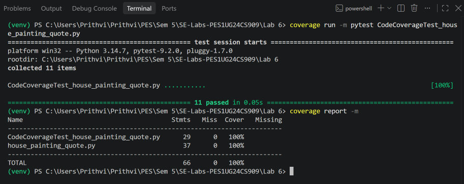
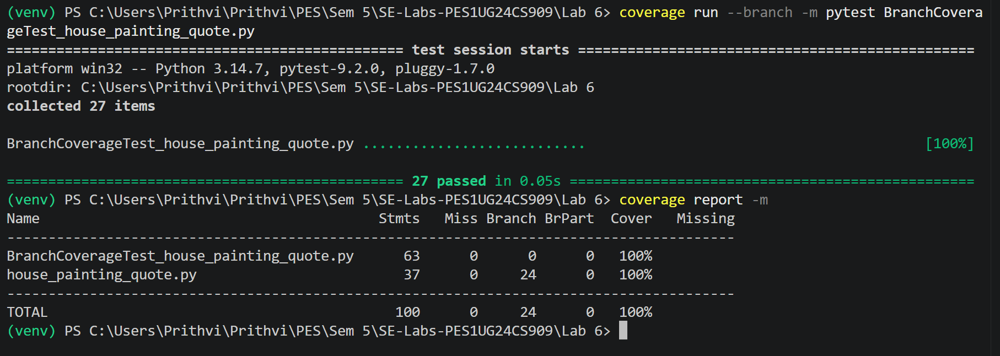

# L6_L7_63 — House Painting Quote

Lab 6: Code and Branch Coverage

## About

A small Python module that quotes house painting jobs by paint type, area, coats and location, works out how much paint to buy and estimates how many days a crew needs.

## Files

| File | Description |
|------|-------------|
| `house_painting_quote.py` | The module under test |
| `test_house_painting_quote.py` | Starter test file |

Keep all your Lab 6 work in this `LAB6` folder. Lab 7 will be added to this repo later.

Refer to the lab handout for instructions.

---

## Work Done (PES1UG24CS909)

### Results (`house_painting_quote.py`)

| Test file | Tests | Line coverage | Branch coverage |
|-----------|-------|---------------|-----------------|
| `test_house_painting_quote.py` (starter) | 2 | 51% | 44% |
| [CodeCoverageTest_house_painting_quote.py](CodeCoverageTest_house_painting_quote.py) | 11 | **100%** | 95% (missing `12->14`, `40->42`, `42->44`) |
| [BranchCoverageTest_house_painting_quote.py](BranchCoverageTest_house_painting_quote.py) | 27 | **100%** | **100%** |

The code coverage tests execute every line, but three decisions were only taken one way: an interior job (`if is_exterior` false), an area that is an exact multiple of a day's work (`if area_sqft % per_day` false), and a job without wallpaper removal. The branch coverage tests add those cases, plus boundary values: area exactly 2000 vs 2001 (discount), cost exactly 5000 vs 4980 (minimum charge), zero coats, negative area, exact litre multiples and one painter.

### Screenshots

**Code coverage** (`coverage run -m pytest CodeCoverageTest_house_painting_quote.py`): 11 passed, 100% line coverage



**Branch coverage** (`coverage run --branch -m pytest BranchCoverageTest_house_painting_quote.py`): 27 passed, 24/24 branches, 100% branch coverage



### Commits

| Commit | Change |
|--------|--------|
| `2fc47c7` | Original module, starter tests, initial coverage |
| `caee8d8` | Code coverage test cases (100% line) |
| `ae783a5` | Branch coverage test cases (100% branch) |

### Files

| File | Contents |
|------|----------|
| [house_painting_quote.py](house_painting_quote.py) | Module under test (unchanged) |
| [test_house_painting_quote.py](test_house_painting_quote.py) | Starter tests (unchanged) |
| [CodeCoverageTest_house_painting_quote.py](CodeCoverageTest_house_painting_quote.py) | Test cases for code (line) coverage |
| [BranchCoverageTest_house_painting_quote.py](BranchCoverageTest_house_painting_quote.py) | Test cases for branch coverage |
| [coverage_reports/](coverage_reports/) | Full terminal output for the initial, code and branch coverage runs |
| [screenshots/](screenshots/) | Terminal screenshots of the coverage results |

### Running

```bash
python -m venv venv
venv\Scripts\activate            # Windows  (source venv/bin/activate on Linux/macOS)
pip install coverage pytest

# Code coverage
coverage run -m pytest CodeCoverageTest_house_painting_quote.py
coverage report -m

# Branch coverage
coverage run --branch -m pytest BranchCoverageTest_house_painting_quote.py
coverage report -m
```
